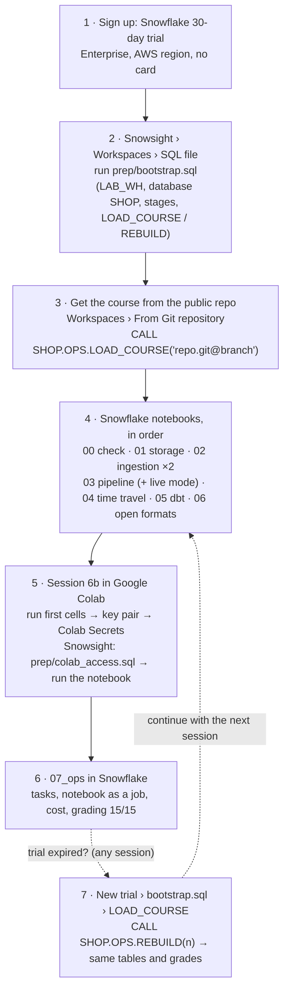
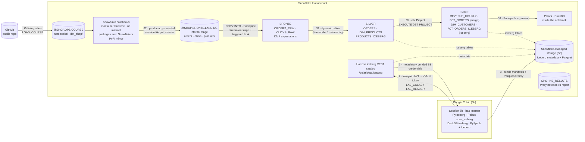

# lab-lakehouse (Snowflake edition)

Course repo and feature test-suite for **Lakehouse Basics on a Snowflake trial account**:
the same six sessions as the Databricks Free Edition version (storage, ingestion,
declarative pipelines, time travel, dbt, open formats) plus operations — and **everything
runs inside Snowflake notebooks**, except Session 6b, which runs in Google Colab. Students
need only a browser, a trial account and a Google account: no laptop installs, no credit card,
no cloud bucket of their own.

What works and what doesn't on a trial, with evidence: [docs/snowflake-feasibility.md](docs/snowflake-feasibility.md).
For trainers (topics, setup, session guide with expected results, grading, troubleshooting): [docs/trainer-manual.md](docs/trainer-manual.md).
Databricks Free Edition vs Snowflake trial, feature by feature: [docs/platform-comparison.md](docs/platform-comparison.md).

## What a student does

Browser only: Snowsight (Snowflake's web UI) and Google Colab.



## Architecture and data flow

Everything except Session 6b stays inside the Snowflake account. The data generator runs in a
Snowflake notebook. Files land in an internal stage, and tables live on Snowflake storage.
Iceberg tables are on Snowflake-managed storage, with no bucket of your own.



| What | Where it runs or is stored |
| --- | --- |
| Data generator (`notebooks/producer.py`) | inside the Snowflake notebook `02_ingestion` (and `03_pipeline` live mode) |
| Raw files | internal stage `SHOP.BRONZE.LANDING` |
| Bronze / silver / gold | Snowflake native and dynamic tables; Iceberg tables on Snowflake-managed storage |
| dbt | a dbt Project object in Snowflake, built from `@SHOP.OPS.COURSE/dbt_shop` |
| Open engines on the live Iceberg files | Google Colab only (Session 6b) |
| Your laptop | nothing but a browser |

## For students

1. Sign up for a Snowflake 30-day trial (Enterprise edition, any AWS region; no card).
2. *Projects → Workspaces*: create a SQL file, paste [`prep/bootstrap.sql`](prep/bootstrap.sql), **Run All**.
3. Bring the notebooks into a workspace (*Workspaces → From Git repository*, or upload the
   `notebooks/` folder) and pick **Container Runtime**, compute pool `SYSTEM_COMPUTE_POOL_CPU`,
   warehouse `LAB_WH`. Packages in `notebooks/requirements.txt` come from Snowflake's PyPI mirror.
4. Run the notebooks in order:

| Notebook | Session | Snowflake features |
| --- | --- | --- |
| `00_check_setup` | 0 | trial limits, Enterprise features, packages, egress |
| `01_storage` | 1 | stage upload from a notebook, `INFER_SCHEMA` table, managed **Iceberg** table + Horizon REST metadata |
| `02_ingestion` | 2 | `COPY INTO` (load history, schema evolution, `ON_ERROR`), **Snowpipe**, stream-triggered **task** |
| `03_pipeline` | 3 | **dynamic tables** (silver/gold), **data metric functions** with expectations, refresh history |
| `04_time_travel` | 4 | query history, the table before/after the bad update (`BEFORE`/`AT (STATEMENT)`), version syntax (`AT (VERSION =>` snapshot) on Iceberg), clone + `SWAP` restore, `UNDROP`, retention, clustering |
| `05_dbt` | 5 | **dbt Projects on Snowflake**: incremental merge, Iceberg model, tests, docs |
| `06_open_formats` | 6 | Snowflake SQL vs **Polars** vs **DuckDB** via Arrow; Iceberg snapshots + time travel |
| `07_ops` | 7 | scheduled task, task-run notebook (a "job"), Git → stage, credits, grading |
| `colab/06b_open_engines` | 6b | **outside Snowflake** (Google Colab): PyIceberg, Polars, DuckDB and PySpark read the Iceberg files directly via the Horizon REST catalog |

Session 6b is the one part that runs in **Google Colab** (free, browser only): Snowflake notebooks
on a trial have no egress to storage, so open engines can't read Iceberg files there. Colab can.
Setup: run the notebook's first cells (they make a key pair), add the Colab secrets, then run
[`prep/colab_access.sql`](prep/colab_access.sql) (read-only role `LAB_READER`, service user `LAB_COLAB`).

### Trial expired? Rebuild on a new account

A trial lasts 30 days. On a new trial, follow [`prep/new_account.sql`](prep/new_account.sql) — all
in Snowsight, no laptop:

1. run `prep/bootstrap.sql` (warehouse, `SHOP`, stages, and the procedures below);
2. `CALL SHOP.OPS.LOAD_COURSE('https://github.com/<org>/lab-lakehouse.git@<branch>')` for a public
   repo, **or** upload `notebooks/` + `dbt_shop/` to stage `SHOP.OPS.COURSE` and `CALL SHOP.OPS.LOAD_COURSE('')`;
3. `CALL SHOP.OPS.REBUILD(<last finished session>)` — replays the session notebooks headlessly
   with the class arguments (~2 min each). The producer is seeded, so tables and grades come
   out identical to the old account;
4. continue with the next notebook.

`02_ingestion` takes arguments (`--start --count --malformed-at --with-task --interval`):
the first lab run uses the defaults (files 1–10); the second uses
`--start 11 --count 25 --malformed-at 15 --with-task 1`. Class mode: `--interval 60`.

`03_pipeline --live-minutes 5` (or `args(live_minutes=5)`) is **live mode**: one new file a minute
flows producer → stage → triggered task → bronze → silver → gold with no manual refresh
(gold `TARGET_LAG = '1 minute'`); about 1–1¾ min from file to gold. It cleans up afterwards, so
grading still expects 35 files.

## For course staff: the headless test-suite

The harness deploys the notebooks as a **notebook project** and runs each one in a fresh
container with `EXECUTE NOTEBOOK PROJECT` — the same code students run interactively.

```bash
uv sync
cp .env.example .env              # SNOWFLAKE_CONNECTION_NAME = a key-pair connection in ~/.snowflake/connections.toml
uv run pytest                     # bootstrap, reset SHOP, deploy, run sessions 0–7 (~30 min)
LAB_NEW_ACCOUNT=1 uv run pytest tests/test_s9_new_account.py   # drop everything, rebuild like a new trial (~20 min)
uv run python -m lab.build        # rebuild notebooks/*.ipynb from notebooks/src/*.py after editing
uv run python -m lab.runner run 02_ingestion --start 1 --count 10   # one notebook, prints its report
LAB_NO_RESET=1 LAB_NO_DEPLOY=1 uv run pytest tests/test_s6_open_formats.py
LAB_COLAB=1 uv run pytest tests/test_s6b_colab.py   # Colab stand-in: clean Linux container + Java 17 (needs Docker)
```

Findings (timings, error texts, what each probe returned) go to `reports/findings.json`.

## Layout

```
prep/        bootstrap.sql (account setup + LOAD_COURSE / REBUILD procedures), new_account.sql (expired trial),
             colab_access.sql (Session 6b read-only access), reset.sql (harness: wipe course state)
notebooks/   *.ipynb (generated, what students open), src/*.py (sources), lab_nb.py, producer.py, grade.py,
             requirements.txt, colab/ (Session 6b notebook for Google Colab)
dbt_shop/    dbt project run natively (EXECUTE DBT PROJECT); macros/iceberg_table.sql
lab/         harness: connection, notebook build, deploy + headless runner
tests/       test_s0 … test_s7, one file per session; test_s9_new_account (opt-in); offline test_build
docs/        snowflake-feasibility.md — verified possible / not possible on a trial; trainer-manual.md;
             platform-comparison.md — Databricks Free Edition vs Snowflake trial
```
