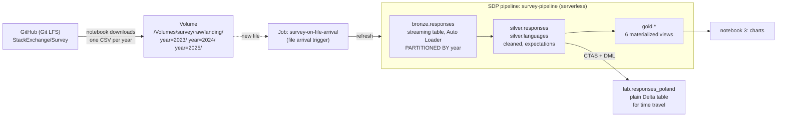

# lab-lakehouse · Introduction to data engineering on Databricks

A one-session lab on **Databricks Free Edition** (no credit card) with real data: the
[Stack Overflow Developer Survey](https://github.com/StackExchange/Survey/tree/main/packages/archive)
2023, 2024 and 2025 (~460 MB of CSV, 204 k answers). Everything runs in the browser, in Databricks
notebooks — no laptop setup.

What students do:

* land raw files in a **Unity Catalog volume**
* load them with **Auto Loader** into a bronze table **partitioned by year**, with schema evolution
* clean them into **silver** and aggregate into **gold** with a **Spark Declarative Pipeline** (SDP)
* make the pipeline run **by itself when a new file arrives** (job with a file arrival trigger)
* analyse with Spark SQL → pandas → matplotlib
* explore **Delta versions, history and time travel** (`DESCRIBE HISTORY`, `VERSION AS OF`, `RESTORE`)

## Architecture



## Student steps

1. Sign up for [Databricks Free Edition](https://www.databricks.com/learn/free-edition).
2. **Workspace → Create → Git folder**, URL `https://github.com/biodatageeks/lab-lakehouse`, branch
   `databricks-survey`. (Public repository: no token needed.)
3. Open the folder `survey/` and run the notebooks in order, each with **Run all**:

| notebook | what happens | time |
|---|---|---|
| `00_setup` | catalog `survey`, schemas, volume; look at the files before loading (size, columns, LFS, BOM) | 1 min |
| `01_pipeline` | downloads 2023 + 2024; creates the pipeline and the job; first load (*Run now*) | 3-4 min |
| `02_new_data_arrives` | downloads 2025 — the **trigger** starts the pipeline on its own; schema evolution; history | 4-5 min |
| `03_analysis` | Spark SQL → pandas → charts (languages, pay, AI, remote work, heatmap) | 2 min |
| `04_time_travel` | ten versions of a Delta table: wrong update, before/after, repair, `RESTORE`; time travel on bronze | 1 min |
| `99_reset` | deletes job, pipeline and the catalog — start over | 1 min |

While notebooks 1 and 2 wait, open **Jobs & Pipelines**: the job's runs (trigger *One time*, then
*File arrival*) and the pipeline graph with rows written and expectation results.

## Repository layout

```
survey/                 everything students open
  00_setup.py … 04_time_travel.py, 99_reset.py   Databricks notebooks (source format)
  helpers.py            download, pipeline/job creation, waiting (keeps notebooks readable)
  pipeline/bronze.py    Auto Loader streaming table (Python SDP)
  pipeline/silver.py    cleaning + expectations (Python SDP)
  pipeline/gold.sql     aggregates (SQL SDP)
docs/trainer-notes.md   timings, what to show in the UI, gotchas, task hints
lab/, tests/            trainer test-suite: runs the notebooks on a workspace from a laptop
```

## Trainer test-suite

```bash
uv sync
cp .env.example .env          # DATABRICKS_CONFIG_PROFILE = a Free Edition profile in ~/.databrickscfg
uv run pytest                 # reset + all notebooks in class order, ~15 min
LAB_NO_RESET=1 uv run pytest  # keep the current state
```

Data: *Stack Overflow Developer Survey*, Stack Exchange Inc., licensed under the
[Open Database License (ODbL) 1.0](https://opendatacommons.org/licenses/odbl/1-0/).
